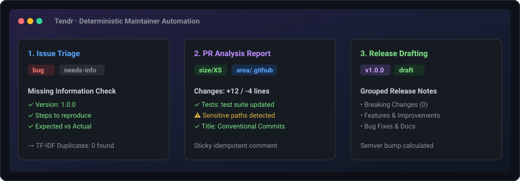

# Tendr

[](https://github.com/ajmaluk/tendr/actions/workflows/ci.yml)
[](https://github.com/ajmaluk/tendr/releases)
[](https://opensource.org/licenses/MIT)
[](https://www.typescriptlang.org/)

> **Free, open-source GitHub Action that helps repository maintainers handle daily workload: issue triage, pull request analysis, and release drafting with zero external APIs.**

---

<div align="center">
  
</div>

---

# How Maintainers Use Tendr to Fix Their Problems

## 1. Match the problem to the feature

| The maintainer's problem | What Tendr does | Setting to use |
|---|---|---|
| People open issues with no details | Replies asking for version, steps, and details; auto-clears when provided | `required-info` |
| Issues are messy and unlabeled | Adds labels like `bug` and `question` automatically | `labels` rules |
| The same question gets asked again and again | Points to similar old issues with TF-IDF cosine similarity | `duplicates` |
| Can't tell if a PR is big or risky | Posts a size label (`size/XS` to `size/XL`) and risky-path report | `pull-requests` |
| Contributors forget tests or docs | Warns when source code changes without tests or documentation | `test-globs`, `docs-globs` |
| Writing release notes takes hours | Drafts grouped release notes and calculates semver bump | `release` |

> *You don't have to use everything. Switch on only the parts you need.*

---

## 2. ⚡ 3-Step Quick Start

### Step 1: Create the triage & PR workflow

Create `.github/workflows/tendr.yml` in your repository:

```yaml
name: Tendr
on:
  issues:
    types: [opened, edited]
  pull_request_target:
    types: [opened, synchronize, reopened]

permissions:
  issues: write
  pull-requests: write
  contents: read

jobs:
  tendr:
    runs-on: ubuntu-latest
    steps:
      - uses: ajmaluk/tendr@v1
        with:
          github-token: ${{ secrets.GITHUB_TOKEN }}
          dry-run: true # start safe; switch to false later
```

### Step 2: Test it safely with Dry-Run

Open a test issue called "it crashes" or open a pull request. In your repository's **Actions** tab, the job summary shows a clean preview table of what Tendr *would* have done: which labels it planned to add and which comment it would post.

Zero modifications are made while `dry-run: true` is active.

### Step 3: Turn it on for real

Change `dry-run: true` to `dry-run: false`. From then on, every new issue and PR is handled automatically.

Tendr **never** closes, merges, or deletes anything. Maintainers stay 100% in control.

---

## 🚀 Automated Release Drafting Workflow

To automate categorized release notes and draft release generation from merged PRs, add `.github/workflows/tendr-release.yml`:

```yaml
name: Draft Release
on:
  workflow_dispatch:
  push:
    tags:
      - 'v*.*.*'

permissions:
  contents: write

jobs:
  draft-release:
    runs-on: ubuntu-latest
    steps:
      - uses: ajmaluk/tendr@v1
        with:
          github-token: ${{ secrets.GITHUB_TOKEN }}
          features: release
```

---

## ⚙️ Configuration Reference

Tendr works immediately out-of-the-box with **zero configuration**.

To customize keywords, required sections, or risky paths, add `.github/tendr.yml` (or `.github/maintainerkit.yml`):

```yaml
# .github/tendr.yml
triage:
  labels:
    - label: bug
      keywords: ["crash", "exception", "traceback", "doesn't work", "regression"]
    - label: question
      keywords: ["how do i", "how to", "is it possible"]
    - label: enhancement
      keywords: ["feature request", "would be nice", "please add"]
  required-info:
    bug: ["version", "steps to reproduce", "expected", "actual"]
  needs-info-label: needs-info
  duplicates:
    enabled: true
    threshold: 0.55
    max-suggestions: 3
    include-closed-days: 180

pull-requests:
  size-thresholds: { xs: 10, s: 50, m: 250, l: 1000 }
  test-globs: ["**/*.test.*", "**/*.spec.*", "tests/**", "__tests__/**"]
  docs-globs: ["README.md", "docs/**", "CHANGELOG.md"]
  risky-globs: ["**/auth/**", "**/migrations/**", ".github/workflows/**", "package-lock.json"]
  require-conventional-title: true
  require-linked-issue: false

release:
  categories:
    - { title: "Breaking Changes", labels: ["breaking"] }
    - { title: "Features", labels: ["enhancement"], types: ["feat"] }
    - { title: "Bug Fixes", labels: ["bug"], types: ["fix"] }
    - { title: "Documentation", types: ["docs"] }
    - { title: "Maintenance", types: ["chore", "refactor", "ci", "build", "test"] }
```

📖 **For full documentation and all options, see [docs/configuration.md](docs/configuration.md).**

---

## 🔒 Permissions & Security

Tendr follows the principle of least privilege:

| Permission | Scope | Reason |
|---|---|---|
| `issues: write` | Triage | Apply labels, remove `needs-info`, post sticky missing-info or duplicate comments. |
| `pull-requests: write` | PR Analysis | Apply size/area labels and post/update the sticky review report. |
| `contents: read` | Repository | Read configuration file and commit history. |
| `contents: write` | Release (Optional) | **Only** required if automating draft release creation in a release workflow. |

> [!IMPORTANT]
> **Safety on Fork PRs**: The workflow uses `pull_request_target` so comments can be posted on PRs from external forks. Tendr **never** checks out or executes code from the pull request. It strictly inspects metadata through GitHub's API.

---

## ❓ Frequently Asked Questions (FAQ)

### Does it use AI or LLMs?
**No.** Tendr is 100% deterministic. It uses regex, keyword matching, globs, Conventional Commits specification, and an in-memory TF-IDF + cosine similarity engine written in pure TypeScript. No external AI APIs, no hallucinations, and no unpredictable behavior.

### Does it cost anything?
**No, 100% free.** Tendr runs on GitHub's built-in runners using the automatically provided `GITHUB_TOKEN`. There are no SaaS subscriptions, third-party accounts, or usage fees.

### Is it safe for forks?
**Yes.** When running on `pull_request_target`, Tendr only reads metadata via GitHub API endpoints. It never checks out or runs code from the fork.

### Can Tendr accidentally close an issue or merge a PR?
**Never.** Tendr contains zero code paths to close issues, merge PRs, or delete branches. It only labels, comments, and drafts releases.

### How do I remove it?
Delete `.github/workflows/tendr.yml`. Tendr leaves no external webhooks or database records.

---

## 🤝 Contributing

Contributions are welcome! Please check out [CONTRIBUTING.md](CONTRIBUTING.md) for local development setup, testing guidelines, and conventions.

See our curated list of [Good First Issues](docs/roadmap.md) to get started!

---

## 📄 License

Distributed under the [MIT License](LICENSE).
