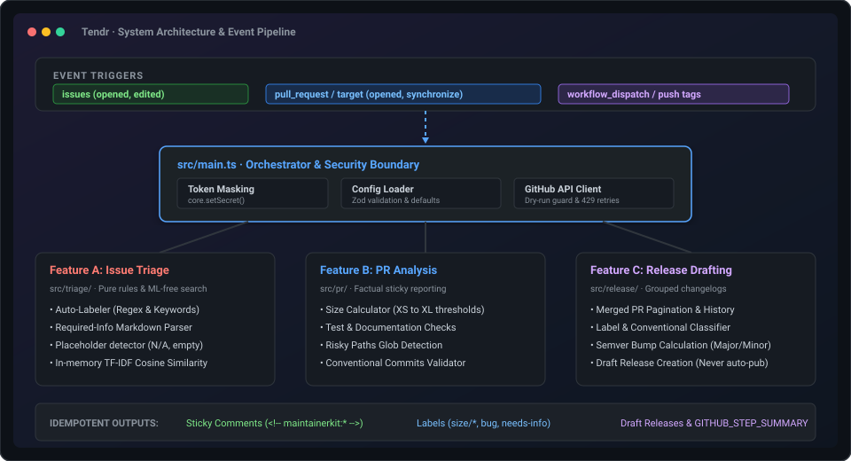
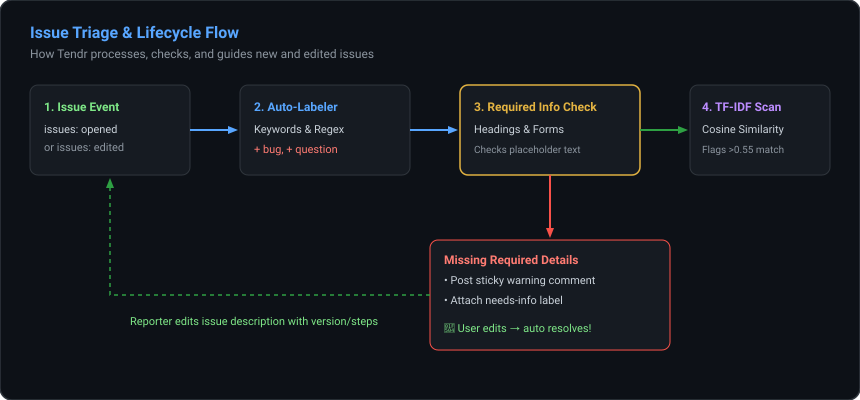
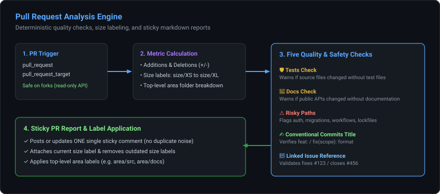
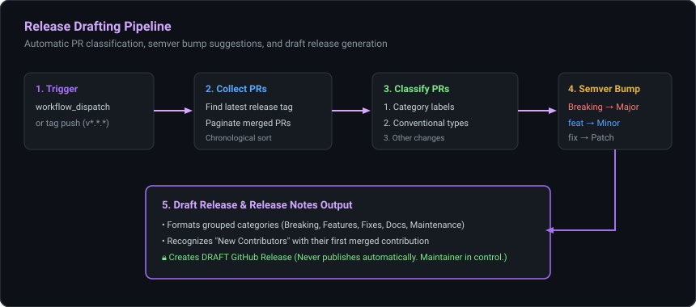

# MaintainerKit Architecture & Design

Tendr (MaintainerKit) is an open-source, deterministic GitHub Action built on TypeScript strict mode. It is designed around principles of safety, zero-cloud execution, least privilege, and idempotency.

---

## 🏛️ System Architecture

  

---

## 🔄 Detailed Event Workflows

### 1. Issue Triage Lifecycle

  

### 2. Pull Request Analysis Engine

  

### 3. Release Drafting Pipeline

  

---

---

## 🔄 Event Routing Flow

1. **Initialization (`src/main.ts`)**:
   - Reads inputs (`github-token`, `config-path`, `dry-run`, `features`).
   - Immediately calls `core.setSecret(token)`.
   - Fetches repository configuration from GitHub API. If absent, applies zero-config defaults.
2. **Issue Triage Routing (`src/triage/`)**:
   - `issues: opened, edited`
   - Evaluates keyword and regex rules against issue title and body.
   - Extracts markdown headings and issue form keys to check required fields (`required-info.ts`).
   - If missing, applies `needs-info` and posts a sticky comment.
   - If previously missing but now satisfied, removes `needs-info` and updates the existing comment.
   - Computes TF-IDF cosine similarity against existing issues to detect duplicates without ML libraries.
3. **Pull Request Analysis Routing (`src/pr/`)**:
   - `pull_request` / `pull_request_target`: `opened, synchronize, reopened`
   - Paginates changed files via GitHub API.
   - Computes line changes and calculates size label (`size/XS` through `size/XL`).
   - Detects test changes, documentation changes, sensitive paths, Conventional Commits titles, and closing issue links.
   - Formats a comprehensive Markdown table and posts or updates the sticky PR report (`<!-- maintainerkit:pr-report -->`).
4. **Release Drafting Routing (`src/release/`)**:
   - `workflow_dispatch`, tag pushes, or explicit `release` feature trigger.
   - Locates latest published release tag.
   - Collects merged PRs since that release via pagination.
   - Classifies PRs into categories and determines semver bump (`major`, `minor`, `patch`).
   - Creates a **draft** release via GitHub API with generated notes and recognizes new contributors.

---

## 🛡️ Core Guarantees

- **No Code Execution**: Tendr only interacts via GitHub's API; it never runs arbitrary checkout or user-provided scripts.
- **Idempotency**: All sticky comments contain unique hidden HTML markers (`<!-- maintainerkit:... -->`). Re-running an action updates existing comments rather than generating duplicates.
- **Dry-Run Safe**: Setting `dry-run: true` executes all analysis logic and writes the planned actions to `GITHUB_STEP_SUMMARY` without executing write calls to GitHub.
- **Zero Third-Party APIs**: 100% of computation happens on the GitHub Actions runner. No external AI services, no SaaS accounts, no billing.
